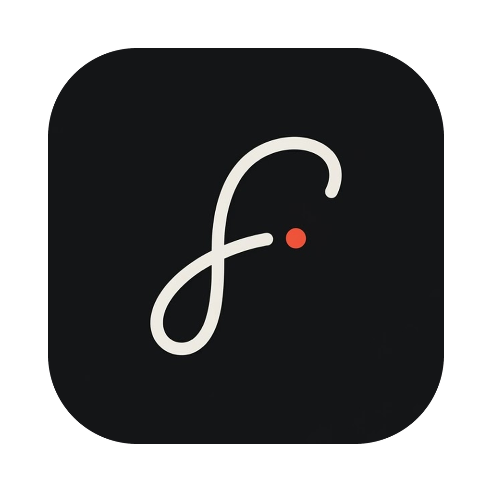

<p align="center">
  
</p>

<h1 align="center">FirstFocus</h1>

<p align="center">
  One ranked list of what needs your attention, built from your Reminders and your Messages.<br>
  A native Mac app. The model that reads your messages runs on your Mac.
</p>

<p align="center">
  <a href="https://github.com/bhatiashash/FirstFocus/releases/latest"><b>Download the latest release</b></a>
</p>

---

## Why FirstFocus

Things you need to do don't only live in your to-do app. Someone texts "can you send me the slides by Friday", you reply "will do", and that promise now lives in a chat thread. FirstFocus reads your Reminders and your Messages, finds the work in them, and ranks all of it in one list.

- **One list.** Reminders and the commitments buried in your texts, ranked together.
- **Local.** A small language model runs on your Mac with [llama.cpp](https://github.com/ggml-org/llama.cpp). Your messages are not sent to a server to be read.
- **You decide.** Anything found in a message waits in Suggested until you approve it. Approving it creates a real reminder.
- **Fast to use.** Check off, snooze or reorder with a swipe or a drag. Add a task from anywhere with a keyboard shortcut.

## How it works

1. FirstFocus reads your open reminders, and new messages from Messages on your Mac.
2. A local model reads each conversation and decides whether it contains something you need to do.
3. Everything lands in one list. **Focus** holds what is overdue, due today or tomorrow, or marked with a priority. **Later** holds the rest.

## Features

- **Focus and Later.** Dated items come first, most overdue at the top, then items by priority. Drag a row to put it where you want; your order wins.
- **Suggested.** Tasks found in messages wait here for Approve or Dismiss. If a later message changes or cancels the plan, the suggestion is updated or withdrawn.
- **Snooze.** Swipe a row to hide it until tomorrow or next Monday at 8:00 AM.
- **Choose your lists.** Advanced has a tick for each of your Reminders lists. Untick one and its reminders disappear from FirstFocus: the Focus and Later lists, Checked Off and the Morning Brief. Lists you make later start ticked.
- **Focus list in Reminders.** Everything in Focus also sits in a Reminders list called Focus, so your phone shows the same Focus. Move a reminder in or out of that list and FirstFocus moves it to Focus or Later to match. The Focus list leaves unticked lists alone. Turn it off in Advanced.
- **Morning Brief.** A text to yourself each morning with your Focus list. You pick the time, how many items, and the layout. It only ever goes to your own conversation with yourself.
- **Quick Capture.** Press ⌥Space in any app to add a reminder. Dates like "tomorrow" or "next friday" are picked up as you type.
- **Zen Focus Mode.** Shrinks the window to a strip showing only Focus.
- **History.** Every decision the model made, with its input and output, so you can see why something showed up or didn't. Correct a wrong call and FirstFocus uses it as an example next time.
- **Model choice.** Download Qwen3-4B, Qwen2.5-3B or Llama-3.2-3B from the Models screen, or use your own `.gguf` file.
- **Updates.** FirstFocus checks for new versions and installs them for you.

## Requirements

- macOS 15 Sequoia or later
- A Mac with Apple silicon (M1 or newer)
- About 3 GB of free space for the language model
- Messages signed in on the Mac, if you want tasks from your texts

## Install

1. Download `FirstFocus-<version>.zip` from the [latest release](https://github.com/bhatiashash/FirstFocus/releases/latest).
2. Unzip it and drag **FirstFocus** into your Applications folder.
3. Open it. The first time, macOS will say it can't check FirstFocus for malicious software, because the app isn't signed with an Apple Developer ID. Open **System Settings > Privacy & Security**, scroll down, and click **Open Anyway** next to FirstFocus.
4. Allow access when asked:
   - **Reminders**, to read and complete your reminders.
   - **Contacts** (optional), to show names instead of phone numbers.
5. To read Messages, give FirstFocus **Full Disk Access**: System Settings > Privacy & Security > Full Disk Access, then turn on FirstFocus. macOS has no prompt for this, so FirstFocus shows a button that opens the right page.
6. Open **Models** in the sidebar and download a model. Qwen3-4B-Instruct (about 2.5 GB) is the most accurate in testing.

On first launch FirstFocus reads your recent notes to yourself in Messages, then keeps up with new messages as they arrive.

### Setting up the Morning Brief

1. Open **Advanced**. The Morning Brief section shows the conversation it will send to: your conversation with yourself in Messages. If none is found, text yourself once from your Mac or iPhone.
2. Click **Send Test**. macOS asks whether FirstFocus may control Messages; click OK.
3. Turn on **Send every day** and pick a time. If your Mac is asleep at that time, the Brief goes out when it wakes, within four hours.
4. **Edit Format…** changes the layout, with a live preview.

## Privacy

- Message text is read from Messages' database on your Mac and judged by a model running on your Mac.
- FirstFocus only writes to Reminders: it creates, edits, completes and deletes reminders when you ask it to, and moves reminders between the Focus list and the lists you ticked for it while that setting is on. It never changes or deletes anything in Messages. The one message it sends is the Morning Brief, to yourself, when you turn it on.
- Codes and verification messages are recognized and skipped. Conversations you mute are never read again.
- **Optional:** Advanced has a Screening setting, off by default, that sends message text (with senders anonymized) to a hosted service to skip obvious non-tasks before the local model runs. It needs your own API key and does nothing unless you turn it on.

## Build from source

You need Swift 6.2, which comes with Xcode 26 or its Command Line Tools (`xcode-select --install`). The full Xcode app isn't required.

```sh
git clone https://github.com/bhatiashash/FirstFocus.git
cd FirstFocus

# Build, bundle and sign the app into .build/FirstFocus.app
CERT_NAME=- ./build.sh          # "-" signs ad hoc

# Run the tests
swift run FirstFocusTestRunner
```

`build.sh` signs with the certificate named in `CERT_NAME`, in the environment or in `~/FirstFocus-data/firstfocus.env`. With neither, it uses `FirstFocus Local Dev` from your keychain, or `DailyOS Local Dev` if that is the one you have. Signing ad hoc (`-`) works, but macOS treats every rebuild as a new app, so you will need to grant Full Disk Access again after each build. A self-signed certificate in your login keychain avoids that.

The tests use a small runner of their own (`Sources/FirstFocusTestRunner`) instead of XCTest, so they run with only the Command Line Tools installed.

### Project layout

FirstFocus was called DailyOS until version 0.1.6. The code, bundle identifier and executable now use the new name.

| Path | What's there |
|---|---|
| `Sources/FirstFocusCore` | Sources, extraction, ranking, storage. No UI and no AppKit. |
| `Sources/FirstFocusApp` | The app model and view models, testable without a running app. |
| `Sources/FirstFocus` | The executable: SwiftUI views and AppKit glue. |
| `Sources/FirstFocusTestRunner` | The test suite. |
| `Sources/ModelEvaluator` | A one-off study comparing the three models ([results](model_evaluation_report.md)). |
| `docs/view-reference.md` | Every screen and control, and what it does. |
| `build.sh`, `release.sh` | Build the app; publish a signed release and update feed. |

## Known limitations

- Apple silicon only.
- Not notarized, so macOS asks you to approve it once on first launch.
- Gmail isn't supported yet.
- Messages reading depends on the layout of Messages' database, which Apple can change between macOS versions.

## License

[MIT](LICENSE)
